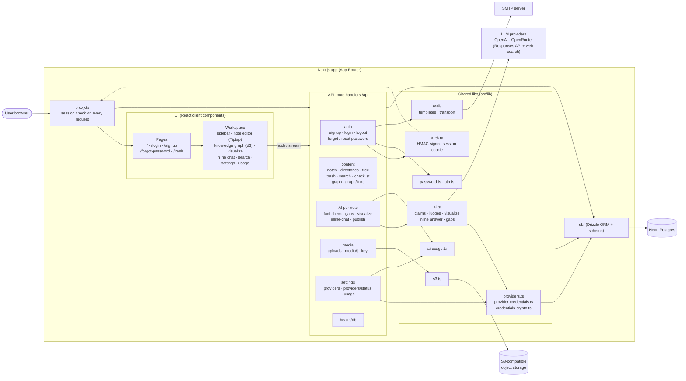
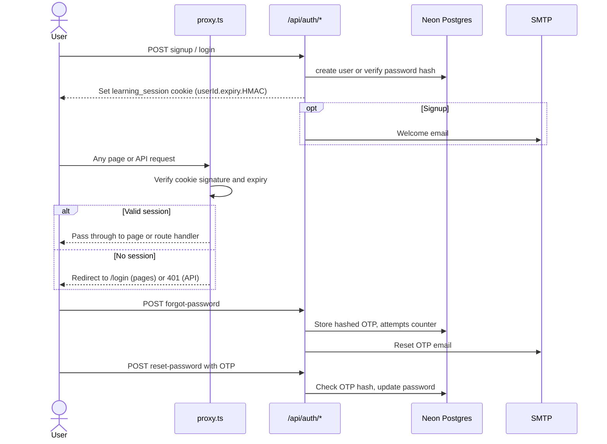
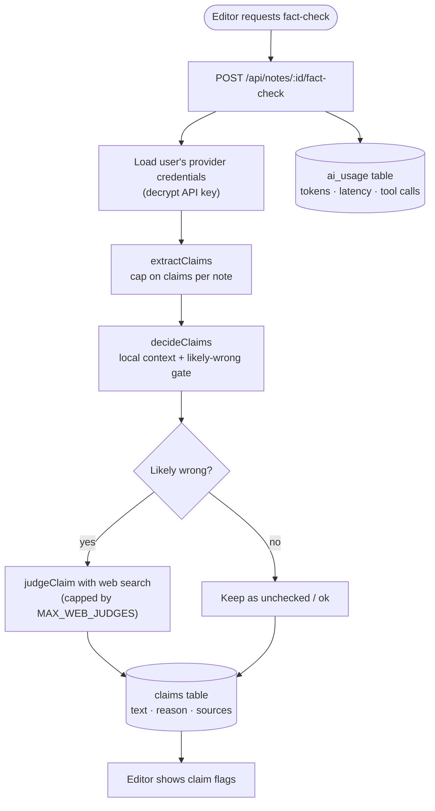
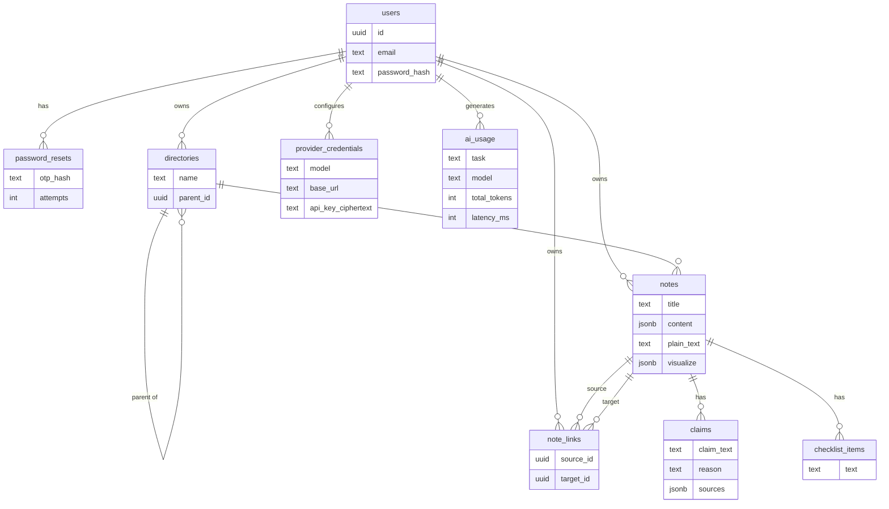

# Scholar architecture

Scholar is a single Next.js app (App Router) that holds both the UI and the API. It stores data in Neon Postgres through Drizzle, stores uploaded media in S3-compatible storage, sends email over SMTP, and calls OpenAI-compatible LLM providers for AI features.

## System overview

## Request and auth flow

## AI fact-check pipeline

Other AI routes follow the same shape: load credentials, call `ai.ts`, record usage.

| Route | Function in `ai.ts` | Result |
|-------|---------------------|--------|
| `gaps` | `findMissingTopics` | Missing-topic suggestions |
| `visualize` | `streamVisualizeTurn` | Streamed diagram turns, saved on the note |
| `inline-chat` | `answerInlineSelection` | Answer about selected text |

## Data model

## Notes

- **Sessions:** a custom HMAC-signed cookie (`learning_session`, 30 days), checked in `src/proxy.ts`. There is no third-party auth library.
- **Provider keys:** each user brings their own API key. It is stored encrypted (`credentials-crypto.ts`) and the base URL is checked against an allowlist of provider hosts.
- **Database client:** Neon HTTP driver, forced to IPv4, created lazily and cached on `globalThis`.
- **Soft delete:** the trash routes restore or purge deleted notes and directories by batch.
- **Further reading:** pipeline details are in `docs/fact-check/`.
